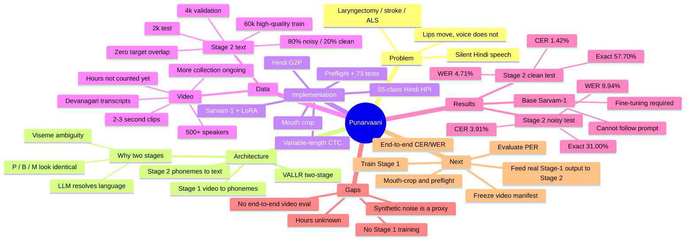

# Punarvaani — Guide Progress Report

> Quick meeting mind map. As of 11 November 2026.
>
> Scope of this report: architecture, implementation, dataset collection, Stage-2 Sarvam-1
> results, and the gaps that still need to be closed. No end-to-end video result is claimed yet.

---

## 1. One-minute summary

Punarvaani is a Hindi visual speech recognition system for people who can move their lips but
cannot phonate. We are adapting the two-stage VALLR recipe to Hindi:

1. **Stage 1:** silent video → 55-class Hindi phoneme sequence.
2. **Stage 2:** phoneme sequence → Devanagari text using Sarvam-1 + LoRA.

**What is done:**

- The full two-stage code path, dataset contract, Hindi G2P, mouth-cropping path, preflight
  checks, and 73 automated tests are in place.
- A noise-aware Stage-2 Sarvam-1 LoRA adapter has been trained from scratch on 60,000
  high-quality Hindi sentence pairs.
- Text-only evaluation is complete: clean test WER 4.71%, noisy test WER 9.94%.

**What is not done:**

- Stage 1 has not been trained yet; the code is ready.
- We do not yet have an end-to-end video result.
- The video dataset has 500+ speakers and more collection is ongoing; total hours are not yet
  counted.

**The main message for the guide:** the Stage-2 half is working and measured. The next critical
step is finalizing the video dataset and training Stage 1, then measuring real end-to-end
phoneme and word error rates.

---

## 2. Mind map



---

## 3. What VALLR is, for context

VALLR is a two-stage visual ASR architecture published at ICCV 2025. The important idea is not a
single video-to-text model. It separates the problem:

1. A visual encoder reads the mouth and predicts a **phoneme sequence** with CTC.
2. A language model turns the phoneme sequence into fluent text.

This helps because many Hindi sounds are visually identical. On the lips, `प`, `ब`, and `म` are
the same viseme. The visual model cannot reliably choose between them. The language model can,
using Hindi vocabulary and grammar.

### What we used from VALLR

- The **two-stage decomposition**: video → phonemes → text.
- The **phoneme CTC bottleneck** for Stage 1.
- The idea of using an LLM as the second stage to resolve visual ambiguity.

### What we did not use

- We did not use VALLR's pretrained weights or its English/LRS3 training data.
- Our Stage 1 is a VALLR-style spatiotemporal ViT implemented in this repo and trained from
  random initialization.
- We did not implement VALLR's character CTC head, viseme head, or per-patient adaptation yet.
- We did not use an AV-HuBERT encoder; that remains a possible comparison, not the current path.

### What is Hindi-specific

- A **55-class Hindi Phonetic Inventory (HPI)** instead of English phonemes.
- A Hindi **grapheme-to-phoneme** converter with schwa deletion and loanword handling.
- **Sarvam-1 (2B) + LoRA** as the Hindi language stage.
- Hindi sentence-level data, not isolated-word VSR.

---

## 4. Implementation: what exists

### Stage 1 — video to phonemes

- `Models/ML_VALLR.py`: spatiotemporal ViT with tubelet patches, spatial token pooling,
  temporal adapter, and a 55-class CTC head.
- Variable-length video support: all frames, per-sample CTC lengths, attention padding masks.
- CTC capacity check `T_ctc >= U + R` to prevent impossible label alignment.
- Mouth-cropping path with MediaPipe face mesh and outer-lip landmarks.
- Training/eval/inference modes in `main.py`.

**Status:** code ready; no Stage-1 training run yet.

### Stage 2 — phonemes to Devanagari

- `Models/Sarvam.py`: Sarvam-1 + LoRA connector.
- Exact prompt contract:

```text
<S2S>
<PHONEMES>
...
</PHONEMES>
<TEXT>
```

- New tag embeddings are saved with the adapter so inference uses the same vectors as training.
- EOS is appended during training; prompt tokens are masked.
- bf16 is auto-selected on the A5000 to avoid the fp16 GradScaler failure.
- Base-tokenizer fallback if an adapter folder omits `tokenizer.model`.
- Validation, best-checkpoint selection, and checkpoint retention are configured.

### Data and quality

- Hindi G2P with schwa deletion and loanword vowels.
- Speaker-disjoint Stage-1 splitting.
- Stage-2 grouped split by normalized target; no train/val/test target overlap.
- Preflight checks for dataset, adapter, tokenizer contract, runtime, GPU, and disk.
- 73 automated tests pass.

---

## 5. Dataset collection progress

### Video dataset

- **500+ speakers** collected so far.
- **2–3 second clips** with **Devanagari transcripts**.
- Collection is still ongoing.
- **Total hours are not yet counted.**

What is missing for a proper report:

- exact clip count;
- exact hours;
- clips per speaker;
- speaker metadata and split assignment;
- crop success rate after media-pipe preprocessing.

Do not claim “500+ speakers” means “enough hours.” Those are different numbers.

### Stage-2 text dataset

The 60k Stage-2 training set is separate from the video data:

| Split | Rows | Purpose |
|---|---:|---|
| Train | 60,000 | 80% noisy / 20% clean prompts |
| Validation | 4,000 | noisy prompts, checkpoint selection |
| Test | 2,000 | noisy prompts, final Stage-2 test |
| Clean counterparts | 4,000 / 2,000 | clean comparison |

- Built from 200,000 source rows.
- 159,757 unique normalized targets.
- 104,299 passed the high-quality filters.
- Filters: 6–22 words, 30–150 characters, pure Devanagari, no rare characters, no repeated
  matras, unique-word ratio ≥ 0.6, valid HPI G2P.
- Zero target overlap between train, validation, and test.
- Noisy prompts use viseme substitutions, drops, and duplications.
- Clean counterparts use the exact G2P prompt for the same target.

Why 60k instead of all 200k: the old 200k set had duplicates and a leaked validation split. The
new set is deduplicated, filtered, and split by target.

---

## 6. Stage-2 fine-tuned LLM metrics

Adapter: checkpoint 15000, LoRA r=16, trained on the 60k v2 set. Text-only evaluation.

| Split | Exact match | CER | WER |
|---|---:|---:|---:|
| Validation, clean | 58.10% | 1.49% | 4.76% |
| Test, clean | 57.70% | 1.42% | 4.71% |
| Validation, noisy | 33.20% | 3.94% | 9.95% |
| Test, noisy | 31.00% | 3.91% | 9.94% |

### How to read these numbers

- **Clean:** perfect G2P phonemes → Hindi text. This measures the adapter’s clean mapping.
- **Noisy:** the same targets with synthetic viseme substitutions, drops, and duplications. This
  is a proxy for Stage-1 errors.
- Exact match is strict: one wrong word or character fails the sentence. CER/WER are the better
  summary.
- Test and validation agree closely, so the adapter generalizes; it is not just fitting the
  validation split.
- The clean → noisy gap is about **+5.2 WER points**. The adapter handles moderate noise but does
  not fully correct it.

### Base-model sanity check

Base Sarvam-1 without the adapter, on clean validation, produced:

```text
exact 0.00%, CER 174%, WER 198%
```

This is not a fair measure of Sarvam-1’s Hindi ability. The base model has not seen the
`<S2S>…<PHONEMES>…<TEXT>` tags; their embeddings are random. It shows that the task prompt is
not zero-shot for the base model and that the adapter is necessary.

### What these metrics are not

- They are **not video results**.
- They are **not end-to-end WER**.
- The noisy test uses **synthetic** noise, not real Stage-1 output.
- They do not prove clinical usability.

---

## 7. Current gaps and risks

| Gap / risk | Current status | Why it matters |
|---|---|---|
| Stage 1 not trained | Code ready, no run | No video-to-phoneme PER yet |
| No end-to-end result | Not measured | The product metric is unknown |
| Video hours unknown | 500+ speakers, hours uncounted | Cannot estimate data sufficiency |
| Synthetic noise only | 12% swap, 3% drop, 2% dup | Real Stage-1 errors may differ |
| Clean/noisy gap | 4.71% → 9.94% WER | Adapter corrects some, not all, noise |
| Base baseline approximate | Random tag embeddings | Not a fair LLM benchmark |
| Clinical validation absent | No patient data yet | Research prototype, not a medical claim |

---

## 8. Next milestones

1. **Finalize the video dataset manifest**
   - clip count, speaker count, hours, clips per speaker;
   - transcript quality checks;
   - speaker-disjoint train/val/test split.

2. **Mouth-crop preprocessing**
   - run `scripts/preprocess_lips.py`;
   - check crop success rate;
   - visually inspect a sample of crops.

3. **Preflight the Stage-1 dataset**
   - pair validation, transcript validation, CTC capacity, speaker split, disk/GPU.

4. **Train Stage 1**
   - four gates: tests, preflight, overfit micro-batch, 20% trial;
   - then full training;
   - report Stage-1 PER, loss, and dropped samples.

5. **Evaluate real Stage-1 output through Stage 2**
   - take held-out video, produce real phoneme sequences;
   - run the 15000 adapter on those phonemes;
   - report CER/WER, not clean G2P loss.

6. **End-to-end evaluation**
   - video → phonemes → text;
   - compare with the base LLM and, if feasible, an external VSR baseline.

---

## 9. Decisions to ask the guide

1. **Video data target:** how many hours and speakers should we aim for, and how many clips per
   speaker?
2. **Compute:** what GPU time is available for Stage-1 training and evaluation?
3. **Evaluation:** which held-out protocol and which clinical/partner input should define
   success?
4. **Priority:** should the next block be Stage-1 training, more video collection, or Stage-2
   calibration on real phonemes?

---

## 10. Short answers to likely questions

**“Is this VALLR?”**
It is VALLR-inspired: the same two-stage idea and phoneme bottleneck, but our own Hindi Stage 1,
Hindi G2P, and Sarvam-1 Stage 2. We did not use VALLR’s weights or English data.

**“Why not a single video-to-text model?”**
Viseme ambiguity. `प/ब/म` are identical on the lips. The phoneme stage keeps the visual problem
honest; the LLM resolves language ambiguity.

**“What is the biggest result so far?”**
The Stage-2 adapter is stable on unseen text: clean test WER 4.71%, noisy test WER 9.94%, with
validation and test agreeing closely.

**“What is the biggest missing result?”**
Stage-1 PER and end-to-end video WER. Stage 1 is implemented but not trained.

**“How much data do we have?”**
500+ speakers of 2–3 second clips with Devanagari transcripts; more collection is ongoing; total
hours are not yet counted.

**“Is the noisy result real Stage-1 output?”**
No. It is synthetic noise designed to mimic viseme errors. The real test comes after Stage-1
training.

---

## 11. Claims to avoid in this meeting

- Do not claim end-to-end video WER.
- Do not claim clinical or patient validation.
- Do not claim state-of-the-art Hindi VSR.
- Do not equate 500+ speakers with hours of usable data.
- Do not compare the 4.71% clean Stage-2 WER with published video WER numbers; they are different
  tasks and metrics.

---

## 12. Appendix: what changed in the current Stage-2 run

- Old attempt: 196k rows, clean-only prompts, 23% validation overlap with training.
- New attempt: 60k unique, filtered, grouped, zero-overlap; 80% noisy / 20% clean training.
- Adapter: LoRA r=16, alpha=32, tag embeddings saved with the adapter.
- Best checkpoint: 15000. Validation began rising at 15500 and 16000, so training stopped and
  15000 was kept.
- Evaluation: text-only Stage 2, four splits: clean/noisy × validation/test.
